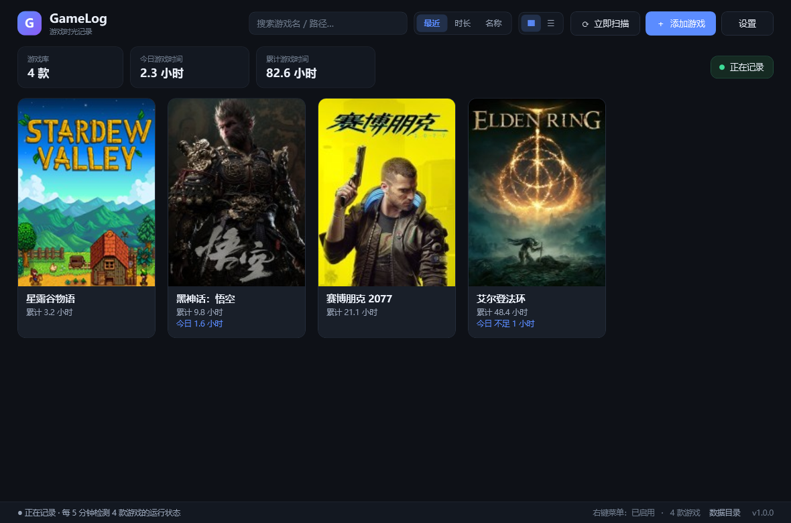
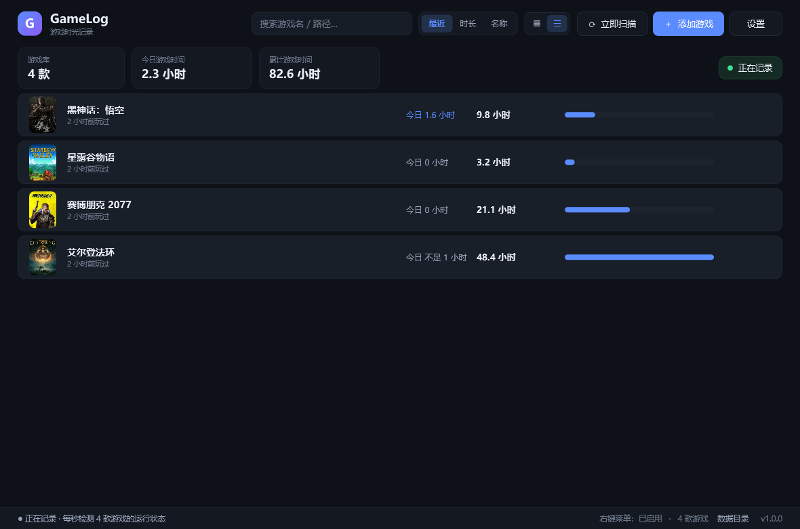
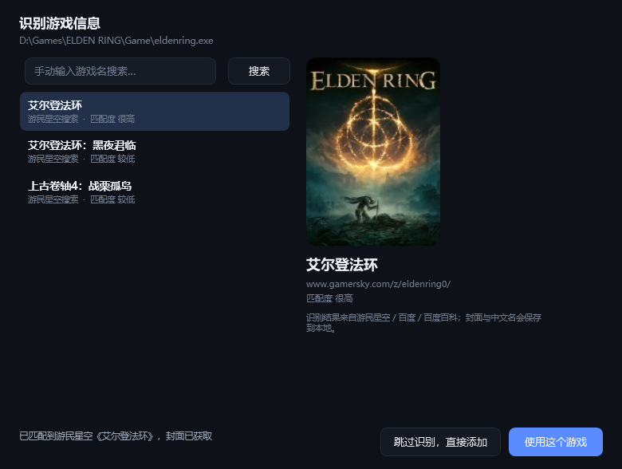
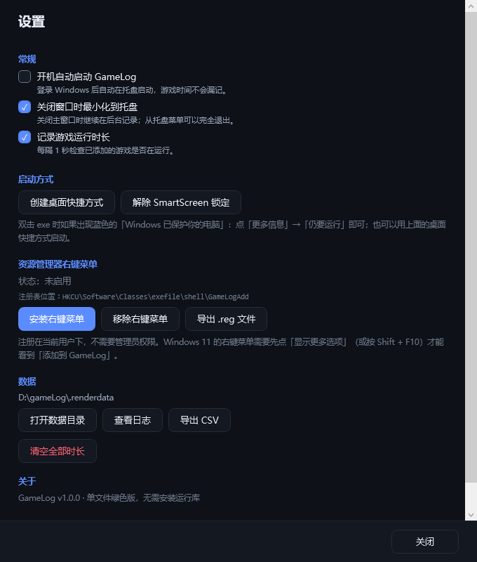

# GameLog · 游戏时光

一个 Windows 桌面小工具：把游戏 exe 用右键菜单加进来，自动识别游戏的中文名与封面，并在后台记录你在这台电脑上为每款游戏花了多少时间。

[](LICENSE)
[](https://github.com/420337636/GameLog/actions/workflows/build.yml)
[](https://github.com/420337636/GameLog/releases)



列表布局（时长进度条以最长的游戏为满格）：



---

## 功能

- **右键菜单添加**：在资源管理器里右键任意 `.exe` →「添加到 GameLog」，直接加入游戏库。
- **拖拽添加**：把游戏 exe（可一次多个）直接拖进主窗口，松手即开始识别。
- **自动发现**：默认每 5 分钟扫描一次运行中的程序，识别为游戏就自动加入列表；系统盘、Program Files 里的程序会被跳过（**Steam 游戏库除外**），同一目录只加一个进程；加入前会先确认「是不是游戏」，工具软件会被拦下；判断过的非游戏和手动删除过的游戏会记住，不再重复分析。主界面右上角有「⟳ 立即扫描」，可以马上扫一次。
- **自动识别游戏**：根据 exe 名称、所在文件夹、文件路径等信息，用百度、百度百科、游民星空以及百度搜到的游戏网页综合判断是什么游戏，尽量取到中文名与竖版封面。
- **时长记录**：后台监控进程，统计每款游戏的累计时长、今日时长、本次运行时长；游戏在运行中时卡片会显示「运行中」。
- **游戏卡片墙 / 列表**：主界面可一键切换「卡片」和「列表」两种布局；卡片显示封面 + 中文名 + 时长，列表额外显示以最长时长为满格的时长进度条。时长统一以小时为单位，不足 1 小时显示「不足 1 小时」。
- **托盘常驻**：关闭窗口后继续在托盘记录，双击托盘图标恢复；可设置开机自启。
- **数据导出**：一键导出 CSV；游戏库与设置保存在本地。



---

## 快速开始

1. 把 `GameLog.exe` 放到一个固定目录（例如 `D:\Tools\GameLog\`），建议把 `icon.ico` 放在同一目录（托盘和窗口图标会更好看）。
2. 双击 `GameLog.exe`。首次启动会自动注册右键菜单（只写当前用户 `HKCU`，**不需要管理员权限**）。
3. 在游戏 exe 上点右键 →「添加到 GameLog」。
   - Windows 11：先点「**显示更多选项**」，或按 `Shift + F10`，就能看到。
   - 也可以直接把 exe **拖进主窗口**（支持一次拖入多个），效果一样。
4. 在识别窗口里确认游戏（可以切换候选，也可以手动搜索正确的名字）→ 点「使用这个游戏」。
5. 之后正常启动游戏即可，时长会自动累计，不需要开着主窗口。

> 也可以点主界面右上角的「＋ 添加游戏」手动选择 exe。

---

## 界面说明

- **顶部**：搜索框（按名称或路径过滤）、排序（最近 / 时长 / 名称）、布局切换（卡片 / 列表）、「立即扫描」、「添加游戏」、「设置」。
- **统计条**：游戏数量、今日游戏时间、累计游戏时间；右侧「正在记录 / 已暂停」可直接点击切换。
- **游戏卡片**：双击启动游戏；右键菜单包含：
  - 启动游戏 / 在文件夹中显示
  - 重新识别游戏信息 / 更换封面…
  - 重置时长 / 从列表移除
- **底部状态栏**：监控状态、右键菜单是否启用、数据目录链接。

卡片的右键菜单：




---

## 识别是怎么做的

识别不局限于游民星空，会按顺序尝试多个来源，直到拿到可信度足够高的结果：

1. 从 exe 文件名、所在文件夹、上级目录提取关键词，自动过滤 `Game`、`Binaries`、`Win64`、`Launcher`、`Shipping` 这类无意义目录名。
2. **游民星空**：搜索游戏专区，取中文名和竖版封面（`image.gamersky.com/zqimg/<slug>/image/cover.jpg`）。
3. **百度搜索**：从结果标题/摘要里提取候选中文名（`《…》`、`…游戏专区`、`…_3DM` 等），再回游民星空核对；候选名如果原样出现在百度结果里会额外加分。
4. **百度百科**：查词条拿到规范中文名、简介与封面（词条必须确实是游戏，公司/人物类词条会被排除）。
5. **百度结果里的网页**：抓取 3DM、游侠、九游、官网、新闻站等页面的 `og:image` 封面与标题，作为最后的名称与封面来源；这类结果会做「像不像游戏名」的过滤，避免把泛化文件名硬凑成游戏。
6. 中文名优先：如果最可信的结果是英文名，而列表里有可信的中文名，会优先用中文名。
7. 识别结果不理想时：在识别窗口里手动输入名字搜索，或点「跳过识别，直接添加」，之后也可以在卡片右键菜单里「重新识别」。
8. 百度百科经常弹安全验证、部分站点会限流，失败会自动跳过；连续网络失败会立即停止请求，整体识别有时限（约 16 秒），不会一直卡住。

已实测可正确识别的例子：

| 路径 | 识别结果 | 来源 |
| --- | --- | --- |
| `ELDEN RING\Game\eldenring.exe` | 艾尔登法环 | 游民星空 |
| `Cyberpunk 2077\bin\x64\Cyberpunk2077.exe` | 赛博朋克2077 | 百度 + 游民星空 |
| `Black Myth Wukong\b1\Binaries\Win64\b1-Win64-Shipping.exe` | 黑神话：悟空 | 百度 + 游民星空 |
| `只狼\sekiro.exe` | 只狼：影逝二度 | 游民星空 |
| `Forza Horizon 5\ForzaHorizon5.exe` | 极限竞速：地平线5 | 游民星空 |
| `DELTARUNE\DELTARUNE.exe` | 三角符文 | 游民星空（英文名候补） |
| `Schedule I\Schedule I.exe`（游民星空未收录） | Schedule I | 百度结果网页 + 封面 |
| `我的游戏\game.exe`（非游戏） | 无法确定，提示手动输入 | — |

---

## 数据保存在哪

默认目录：`%APPDATA%\GameLog`

```
%APPDATA%\GameLog\
├─ games.json     游戏列表、累计/每日时长
├─ settings.json  设置
├─ covers\        封面图片
├─ logs\app.log   运行日志（排查问题用）
└─ pending.txt    单实例消息（临时文件）
```

- **便携模式**：在 `GameLog.exe` 同目录新建一个空文件 `portable.txt`，数据会改存到该目录下的 `data\`。
- **自动迁移**：如果程序目录下存在之前生成的 `GameLogData\games.json`（比如曾从压缩包/受限环境直接运行过），首次正常启动时会自动把这些记录导入到 `%APPDATA%\GameLog`，不会丢数据。
- **自动退让**：如果 `%APPDATA%\GameLog` 因权限/安全软件无法写入，程序会依次尝试 `%LOCALAPPDATA%\GameLog`、程序目录下的 `GameLogData`、临时目录，并继续正常运行（设置与状态栏里会显示实际使用的目录）。
- 不收集、不上传任何个人数据；程序只在添加/重新识别游戏时访问百度和游民星空。

---

## 常见问题

**右键菜单里没有「添加到 GameLog」？**
- 主窗口顶部如果出现「右键菜单还没启用」，直接点「立即启用」；
- Windows 11 默认折叠旧式菜单：需要点「显示更多选项」或按 `Shift + F10`；
- 如果提示「启用失败」（常见于从聊天附件、压缩包预览、受限环境启动，或被安全软件拦截）：把 exe 放到普通文件夹，用**资源管理器双击**运行一次，让它自己注册；
- 仍然不行：设置 →「导出 .reg 文件」→ 双击合并；
- 也可以完全不用右键：把 exe 拖进主窗口，或点「＋ 添加游戏」。

**为什么时长比实际游戏时间少？**
- 只统计你**添加的那个 exe**的进程运行时间。如果游戏是通过启动器（launcher）进入的，要添加真正的游戏 exe；
- 关闭软件 / 暂停记录期间不计时；
- 休眠唤醒后不计入睡眠时间。

**双击 exe 提示「Windows 已保护你的电脑」（SmartScreen）？**
- 这是 SmartScreen 对**未签名、没有下载量**的新程序的正常提示。点「更多信息」→「**仍要运行**」即可（同一个文件通常只需一次）；
- 如果每次启动都提示：多半是每次运行的都是一份新副本（带「来自 Internet」标记），请固定使用同一个 `GameLog.exe`；
- 也可以右键 exe → 属性 → 勾选「解除锁定」→ 确定；新版「设置 → 启动方式」里也提供了「解除 SmartScreen 锁定」和「创建桌面快捷方式」两个按钮；
- 想彻底不再提示：Windows 安全中心 → 应用和浏览器控制 → 基于声誉的保护 → 关闭「检查应用和文件」（会影响全局，请自行权衡）；
- 分发给他人的话，只有购买代码签名证书（OV/EV）才是根本解决办法。

**启动时提示「对路径 …\AppData\Roaming\GameLog 的访问被拒绝」？**
- 说明当前运行环境不允许写入 `%APPDATA%`（例如在受限沙箱/安全软件里启动）。新版本会自动改用程序目录下的 `GameLogData`，直接点「确定」后重开即可；
- 如果仍失败，把 `GameLog.exe` 放到有写权限的目录（如 `D:\Tools\GameLog\`）再运行。

**识别错了 / 没识别出来？**
- 卡片右键 →「重新识别游戏信息」，或在识别窗口手动输入中文名/英文名搜索；
- 识别会依次尝试游民星空、百度、百度百科、百度结果网页，仍失败通常说明这款游戏太冷门或名字太泛（如 `game.exe`），可以跳过识别后手动更换封面。

**怎么彻底卸载？**
设置里「移除右键菜单」→ 托盘右键「退出」→ 删除 `GameLog.exe` 与 `%APPDATA%\GameLog` 目录即可（不写系统其他位置）。

---

## 从源码构建

要求：Windows 10/11，自带 .NET Framework 4.8（**不需要安装 .NET SDK、Node 或 Python**）。

```bat
build.cmd
```

输出：`dist\GameLog.exe`（单文件，约 200 KB，绿色免安装）。

- 可选的本机签名：`tools\sign-local.cmd`（自签名证书，仅本机信任）；或 `set SIGN_LOCAL=1` 后运行 `build.cmd` 自动签。

- 界面：WPF（纯 C# 代码构建，无 XAML 编译依赖）
- 存储：`games.json` / `settings.json`
- 抓取：`Baidu.cs`、`Gamersky.cs`、`WebSource.cs`、`Identifier.cs`
- 监控：`Monitor.cs`（默认每 5 分钟检测一次，可设 1/5/10 分钟；30 秒自动落盘，退出前补记零头）
- 右键菜单：`ShellMenu.cs`（`HKCU\Software\Classes\exefile\shell\GameLogAdd`）
- 构建：[`.github/workflows/build.yml`](.github/workflows/build.yml)（GitHub Actions，用 Windows 自带编译器）

```
src\
├─ Program.cs        入口、命令行参数、自检/渲染模式
├─ App.cs            应用生命周期、托盘、单实例、IPC
├─ MainWindow.cs     主界面
├─ GameCard.cs       游戏卡片
├─ IdentifyDialog.cs 识别确认窗口
├─ SettingsWindow.cs 设置窗口
├─ Ui.cs             深色主题与控件工厂
├─ Store.cs          数据持久化
├─ Monitor.cs        进程监控与计时
├─ Identifier.cs     关键词提取、打分、识别流程
├─ Baidu.cs          百度搜索结果解析
├─ Gamersky.cs       游民星空搜索/专区页/封面
├─ WebSource.cs      网页/百度百科解析、封面兜底
├─ Net.cs            HTTP（TLS1.2、gzip、编码探测）
├─ Ipc.cs            单实例通信（管道 + 文件回退）
├─ ShellMenu.cs      右键菜单注册/移除/.reg 导出
└─ TrayIcon.cs       托盘图标
```

---

## 开源与代码签名

- 本项目以 **MIT License** 开源，仓库里不含任何用户数据；贡献方式见 [CONTRIBUTING.md](CONTRIBUTING.md)。
- 发布出来的 exe **未做代码签名**，首次运行会出现 SmartScreen「Windows 已保护你的电脑」：点「更多信息 → 仍要运行」即可放行（同一个文件只需一次）。
- 想彻底消除提示只能用受信任 CA 的证书。免费途径（Certum Open Source Code Signing、SignPath Foundation、Microsoft Store 个人开发者）的申请材料清单、GitHub Actions 自动签名配置，都整理在 [docs/open-source.md](docs/open-source.md)。
- 从建仓库到拿到证书的逐步操作（含英文申请信模板）见 [docs/github-publish.md](docs/github-publish.md)。
- 代码签名策略：[CODE_SIGNING.md](CODE_SIGNING.md)；安全问题报告：[SECURITY.md](SECURITY.md)；版本记录：[CHANGELOG.md](CHANGELOG.md)；隐私说明：[PRIVACY.md](PRIVACY.md)。
- 发布版本计划通过 **SignPath Foundation** 的免费开源代码签名（Free code signing provided by [SignPath.io](https://signpath.io/), certificate by [SignPath Foundation](https://signpath.org/)）；签名后 `signtool verify` 可校验发布者。

## English

GameLog is a lightweight Windows playtime tracker. Right-click any `.exe` (or drag it onto the window) to add a game; it identifies the title via Baidu, Baidu Baike, Gamersky and Baidu result pages, downloads a cover, and monitors the process to accumulate play time. Built with C#/WPF against the .NET Framework 4.8 compiler that ships with Windows — no SDK, no installer, no third-party runtime.

- Build: `build.cmd` → `dist\GameLog.exe` (~200 KB).
- License: MIT.
- Status: the released binary is unsigned; see `docs/open-source.md` for code-signing options.

## 免责声明

游戏名称、封面等资料的版权归游民星空及各游戏厂商所有。本工具仅为个人记录游戏时间而抓取公开页面信息，请遵守目标网站的使用条款，不要进行高频抓取或用于商业用途。
